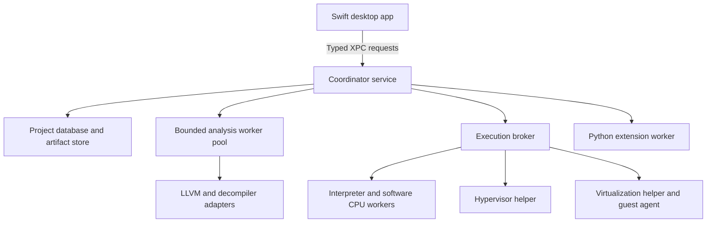
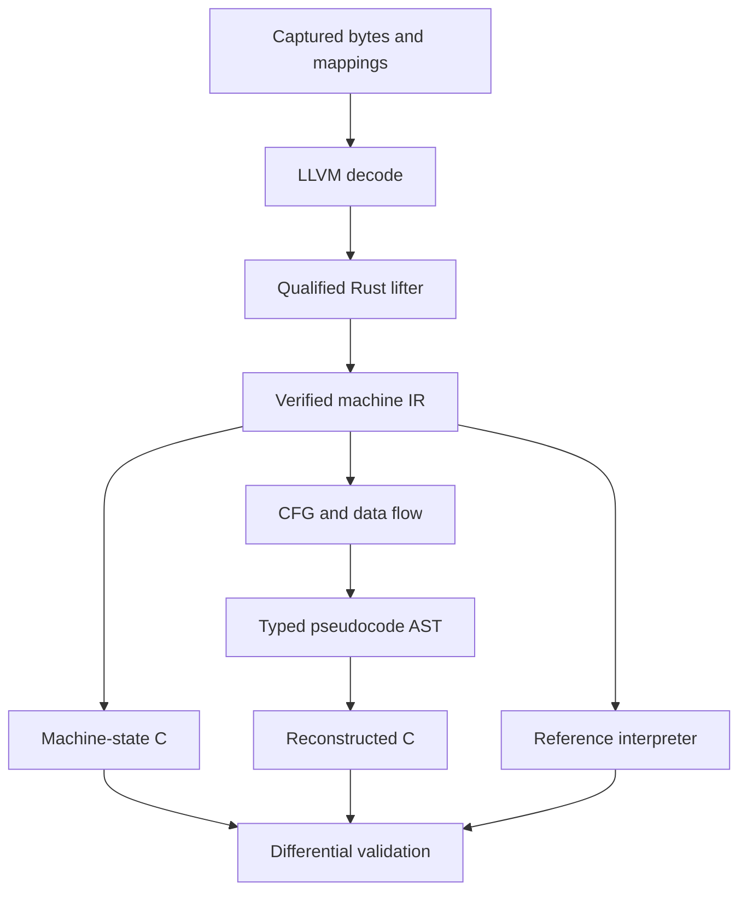

# Apple Silicon Reverse Engineering Workbench Architecture Plan

Version 1.0 • 26 September 2026 • Proposed implementation baseline

Companion to Apple Silicon Reverse Engineering App Specification v1.0. This document defines implementation boundaries, contracts, storage, scheduling, execution and delivery order. It is an architecture plan, not a claim that the application or its backends have been implemented or benchmarked. The product name remains undecided; HindSight is a temporary repository and target identifier.

## 1 Architecture decision

Build a native Swift application around a Rust coordinator with disposable analysis workers. Place all heavyweight engines outside the UI process. Store immutable binary inputs and versioned analysis artifacts on disk. Use one canonical Rust semantic pipeline for execution and strict C export, with a separate mature decompiler adapter for richer exploratory pseudocode.

The first vertical slice opens a Mach-O, displays decoded instructions, saves an annotation and survives an analysis-worker crash. The second lifts a small supported ARM64 function, emits C and compares its result with independently executed fixtures. Hardware execution comes after these contracts work.

The 8 GB reference machine determines defaults: bounded concurrency, one heavyweight execution mode, incremental results and no mandatory AI, VM or Java runtime. Components may share libraries at build time, but their runtime privileges and failure boundaries remain separate.

### System topology



The coordinator is a Swift XPC service wrapper hosting a Rust static library. It is the sole authority for project mutations and resource leases. It does not parse complex binaries, execute guest code or load third-party decompilers itself. An app-level liveness monitor can restart the coordinator after a crash; durable state lives in the project, not in an XPC connection.

## 2 Architectural invariants

1. Opening a file performs no target execution, script execution or network operation.
2. UI-visible data always identifies its input revision and producing analysis revision.
3. Raw bytes, file offsets, unslid addresses, runtime addresses and guest addresses are different types.
4. Decode support, lift support, execution support and C-export support are independently reported.
5. No worker can publish results after its lease is revoked or its job attempt is superseded.
6. Only the coordinator writes authoritative project records. All workers are replaceable.
7. Unknown effects remain unknown. They cannot become no-ops during optimization or export.
8. Optional acceleration cannot alter semantics without a new explicit execution model.
9. Every allocation-heavy job obtains a resource lease before launch and before significant growth.
10. Cancellation preserves previously committed results and marks incomplete scopes explicitly.
11. User annotations are durable records; cache eviction cannot remove them.
12. Export labels distinguish generated, compiled, exercised and differential-tested output.

These invariants become code-review checks and integration tests, not merely documentation.

## 3 Process and privilege map

| Target | Language and resident role | Allowed responsibilities | Must not do |
| --- | --- | --- | --- |
| HindSight.app | Swift, always present | Windows, file selection, view caches, user commands, service health | Parse arbitrary binary formats on main thread; load target code |
| CoordinatorService.xpc | Swift wrapper plus Rust core | Admission, task graph, queries, annotations, persistence, worker supervision | Execute instructions; load scripting extensions |
| BinaryWorker | Rust and LLVM C++ adapter | Validate images, decode ranges, extract bounded metadata | Write project database; initiate network requests |
| SemanticWorker | Rust | Lift, CFG/SSA analysis, pseudocode AST, C emission | Resolve unknown behavior through guesses |
| DecompilerWorker | Small wrapper around pinned native engine | Rich exploratory decompilation | Issue canonical strict-C certificates |
| SoftwareExecutionWorker | Rust interpreter or Unicorn adapter | Function harness execution, bounded trace | Pass guest syscalls to host |
| CompilerWorker | Rust process runner plus selected Clang toolchain | Compile generated C in a fresh temporary directory | Execute project-supplied build scripts |
| ValidationWorker | Rust/C harness | Execute compiler output against controlled fixtures | Load generated native code into the coordinator |
| HypervisorHelper | Swift/C platform adapter | Qualified virtual CPU harnesses | Pretend to provide macOS services |
| VirtualizationHelper | Swift | Full guest lifecycle and guest-agent channel | Assume access to guest process memory through VM APIs |
| DebuggerHelper | Qualified LLDB adapter | User-requested launch/attach and debugger events | Bypass platform process protections |
| PythonWorker | Pinned CPython plus SDK | Brokered reads and proposed annotation transactions | Execute automatically when opening a project |
| InferenceHelper | Optional Swift/Core ML | Explicitly requested suggestions | Become a required analysis dependency |

These are executable roles, not a requirement to keep twelve processes alive. Static sessions normally retain the app, coordinator and at most two admitted heavy workers. Workers are spawned lazily and unloaded after a short configurable idle interval. Never keep both native decompilers and a VM resident merely to reduce the next click's latency.

Code signing and sandbox policies are defined per executable. Static services have no debugger, virtualization or JIT entitlement. Where an OS-enforced restricted worker is not yet qualified, expose that limitation and do not label process separation as a security sandbox. No root service or kernel extension is planned.

## 4 Repository and build graph

| Path | Contents and ownership |
| --- | --- |
| HindSight.xcworkspace | Application, helpers, bridge and test schemes |
| App/ | SwiftUI shell, AppKit editors, view models and command routing |
| PlatformServices/ | Swift XPC wrappers, memory-pressure observer and framework adapters |
| Bridge/ | Versioned C header, ownership utilities and Swift bindings |
| rust/crates/model/ | IDs, address types, coverage, diagnostics and revisions |
| rust/crates/protocol/ | Worker envelopes, codec, validation and capability handshake |
| rust/crates/coordinator/ | Session control and command dispatch |
| rust/crates/scheduler/ | Resource leases, queue policy, cancellation and attempts |
| rust/crates/store/ | SQLite transactions, migrations, blobs and cache index |
| rust/crates/loaders/ | Mach-O, raw image and bundle metadata parsing |
| rust/crates/decode/ | Engine-independent instruction records and LLVM adapter facade |
| rust/crates/ir/ | Bit-vector semantics, verifier and serialization |
| rust/crates/analysis/ | CFG, SSA, summaries, dependencies and type hypotheses |
| rust/crates/pseudocode/ | Structured AST, parser and renderer |
| rust/crates/cgen/ | Strict eligibility checks, C17 emitter and support runtime |
| rust/crates/execution/ | Harness schema, interpreter and backend contracts |
| rust/crates/validation/ | Comparison policies and test evidence |
| rust/crates/cli/ | Headless entry points into the same coordinator contracts |
| native/ | Narrow LLVM, decompiler, Unicorn and LLDB adapters |
| python/ | SDK package, restricted/trusted modes and example scripts |
| schemas/ | Versioned protocol, artifact, harness and export schemas |
| fixtures/ | Source-controlled small known-source fixtures and manifests |
| tests/ | Integration, fault injection, signing and hardware tests |
| benchmarks/ | Workload manifests and reproducible measurement scripts |
| docs/adr/ | Architecture decisions and dependency qualification records |

Crate dependencies point toward model and protocol. Loaders and analysis cannot import the UI, database implementation or scheduler. Workers receive explicit inputs and return artifacts; this permits the CLI and app to share behavior without duplicating analysis code.

Xcode invokes locked Cargo/CMake builds through declared input/output scripts. Build native adapters once per configuration and reuse them across compatible targets. Sign inside out, then package and notarize. Normal builds must work offline after an explicit dependency preparation step. A dependency update is a separate reviewed operation.

Use macOS 14 ARM64 as the proposed deployment floor, with availability gates for newer APIs. The release manifest records exact compiler, SDK, dependency and schema versions. Linux CI can verify portable Rust algorithms, but signing, XPC, memory pressure, JIT and virtualization require macOS testing.

## 5 Ownership and concurrency

The Swift UI uses MainActor only for view state. A SessionClient actor owns XPC requests and reconnects. Each window stores lightweight selection and navigation state; it does not own the project graph or a duplicate instruction database.

The coordinator has a serialized control executor for session state, a single database writer and bounded query tasks. Heavy CPU work never runs on the control executor. Use bounded channels; a failed send under backpressure is handled by pausing or paging, not by creating another unbounded queue.

CPU parallelism is budgeted globally. Two admitted analysis workers do not each receive the full host core count. Begin with one compute thread per heavy worker and an aggregate limit of two. Disable or cap third-party engine thread pools. Use OS quality-of-service hints; do not depend on undocumented performance-core affinity.

Each worker owns its native engine instance and private scratch directory. It cannot reuse pointers across requests or expose engine object layouts across FFI. A memory leak is contained by worker lifetime and measured before reuse.

## 6 Data model and address discipline

### Core identities

| Type | Representation | Meaning |
| --- | --- | --- |
| ProjectId | UUID | Stable project identity |
| SourceId | SHA-256 plus byte length | Exact imported byte stream |
| ImageId | UUID plus source/slice relation | One loaded image or slice |
| ImageRevision | Monotonic project-local integer | Particular mapping and import state |
| FunctionId | Stable UUID within an image revision | Analyst-visible function identity |
| AnalysisRevision | Monotonic project-local integer | Input, settings and annotation hypothesis state |
| ArtifactKey | Hash of canonical dependency description | Exact reproducible derived result |
| JobId and AttemptId | UUIDs | Logical operation and one execution attempt |
| LeaseId | Random opaque token | Revocable resource reservation |
| SessionId | UUID | One execution or debugger session |

A function boundary change creates a new function version while retaining identity when the analyst is editing the same candidate. Merging or splitting candidates records lineage rather than silently reassigning annotations.

### Address types

Define FileOffset, ImageOffset, UnslidVA, RuntimeVA, GuestVA and GuestPA as distinct wrappers over unsigned 64-bit values. An address reference includes ImageId or AddressSpaceId. Arithmetic is checked. A raw integer cannot be passed to an API that expects a runtime address without an explicit mapping operation.

Universal-file offsets include a slice base; segment mapping relates file-backed bytes to virtual ranges. Zero-fill has no corresponding file offset. Relocatable objects require section-plus-offset references until laid out. Runtime mappings carry ASLR slide and mapping epoch. Guest VA-to-PA translation belongs to the execution session, not to the Mach-O loader.

Store full unsigned addresses as fixed 8-byte big-endian blobs where indexed ordering is needed; SQLite signed integers must not truncate high firmware addresses. Encode addresses as hexadecimal strings in JSON. Caches include mapping revision to prevent a rebase from reusing stale references.

## 7 Project storage and commit protocol

A project directory contains manifest.json, project.sqlite, objects/, annotations-export/, scratch/ and optional traces/. Original content in objects/ is immutable. The database stores durable annotations in separate tables from rebuildable analysis; annotations-export/ is an optional readable export, not a second authoritative database.

| Table group | Essential records |
| --- | --- |
| Sources and mappings | source, image, image_revision, segment, section, dependency_image |
| Analysis | function_candidate, function_version, symbol, reference, cfg_edge, type_hypothesis |
| Artifacts | artifact, artifact_dependency, artifact_coverage, cache_entry |
| User records | annotation, annotation_revision, rename, type_override, bookmark |
| Work | job, job_attempt, checkpoint, worker_event_summary |
| Execution | harness, execution_session, trace_chunk, state_checkpoint |
| Evidence | validation_run, comparison_policy, mismatch, export_manifest |

Large instruction arrays, IR blocks and traces are compressed chunk objects. The database indexes ranges and object references. It does not store a row per execution event indefinitely.

Enable SQLite foreign keys, WAL journaling and a bounded page cache. Use short query transactions to avoid indefinitely pinning WAL pages. One coordinator holds an exclusive project-writer lock; a second app instance may open a read-only view or route commands to the owner. Do not use a live project on an unsupported network filesystem; export a closed archive for transport.

Publication protocol:

1. Worker writes an attempt-scoped staging artifact and reports its length, format and hash.
2. Coordinator validates the schema, limits, source revision and active lease.
3. Coordinator rechecks the artifact digest and atomically promotes it into the immutable object store on the same volume.
4. Coordinator commits the artifact and dependency records in one SQLite transaction.
5. Only after commit does the UI receive a published-result event.

A crash between promotion and commit can leave an unreferenced object; a later garbage collector removes it after a grace period. A committed row must never refer to an unpromoted file. Disk-full errors fail the attempt cleanly. Changes to annotations commit independently of background result publication.

Migrations run with a backup and sufficient free space. Unsupported newer schemas refuse writing. Cache purging removes only reproducible artifacts without durable pins. Trace deletion is an explicit retention decision when it removes evidence referenced by a report.

## 8 Import and reproducible input capture

Prefer a private immutable source copy for ordinary projects. Read the selected source through a file descriptor, stream its bytes into a temporary object, hash the captured bytes, and publish only that captured object. Parsing operates on the captured source, not on a pathname that another process may replace.

Check source identity and metadata before and after capture and report detected modifications. The artifact hash identifies exactly the captured stream even when the source filesystem cannot provide an atomic snapshot. An external-reference mode must reverify bytes before reuse and may not promise snapshot consistency for a changing file.

For app bundles, enumerate executable and framework candidates with recursion and entry limits. Resolve symlinks without escaping the chosen import policy. Display unavailable dependencies explicitly. Symbols or debug information may enrich analysis, but are optional and never automatically downloaded.

Pipeline chunks follow file and function boundaries. Hashing uses bounded buffers, metadata parsing validates every range, and instruction decoding starts with visible executable regions. A provisional summary may appear before capture finishes, but provisional artifacts cannot enter strict export or validation.

## 9 Worker protocol and cancellation

Use typed XPC between the app and coordinator/platform helpers. Private inherited socket pairs carry framed messages between the coordinator and internal workers. No listener is exposed to the network. Where descriptors are transferred, use an authenticated local channel and validate descriptor type, size and access mode.

Use a 32-bit frame length followed by versioned UTF-8 JSON for control messages. Reject lengths above 256 KiB before allocation. JSON keeps debugging and Python integration simple; bulk artifacts use a separate versioned binary format with explicit sizes and checksums. Schema definitions are authoritative; generated client types must round-trip against shared fixtures.

Conceptual request shape:

```json
{
  "protocol": {"major": 1, "minor": 0},
  "kind": "analyze_function",
  "request_id": "uuid",
  "job_id": "uuid",
  "attempt_id": "uuid",
  "project_id": "uuid",
  "image_revision": 3,
  "analysis_revision": 9,
  "lease_id": "opaque-token",
  "payload_ref": "immutable-artifact-key",
  "limits": {"memory_mib": 384, "wall_time_ms": 5000}
}
```

Workers handshake with engine/build identity, protocol versions, artifact formats, ISA coverage and cancellation capabilities. Minor additions are negotiated; unknown mandatory fields or major versions fail closed. All path references are broker-issued handles or staging identifiers, not arbitrary worker-requested host paths.

Events have attempt ID, monotonically increasing sequence, event kind and bounded payload. Progress events can be coalesced. Result availability and terminal state cannot be dropped silently. Clients reconnect using a durable event watermark and query current job state if transient events are missing.

Cancellation first revokes publication authority, then sends a cooperative cancel. After one second without termination, the supervisor escalates to process termination and resolves the attempt within the proposed three-second budget. Interruptible native calls are preferred, but a worker may always be discarded. Late responses from a previous attempt are rejected even if their request ID resembles a current job.

Error codes include malformed_input, unsupported_isa, unsupported_semantics, stale_revision, resource_denied, deadline_exceeded, cancelled, engine_crash, permission_denied, disk_full and protocol_violation. Diagnostics contain machine-readable context and a human-readable explanation.

## 10 Scheduling and the memory governor

The scheduler manages a dependency DAG: capture, load, decode, discover, lift, analyse, structure, export and validate. Dependencies are content/revision specific. Completed immutable stages can be reused; failed stages block only their descendants.

Prioritize visible navigation, explicit selected-function requests, validation, then background discovery. Prevent starvation with aging. Deduplicate identical jobs, and let multiple clients subscribe to one result. Cancelling a subscriber does not cancel a shared job still required by another subscriber unless the user requests project-wide cancellation.

### Admission policy

Each job requests memory, scratch disk, CPU slots, backend exclusivity and an estimated deadline. The coordinator grants a lease only if the active profile and pressure state permit it. The effective commitment is measured footprint plus outstanding reserved growth, with conservative attribution of shared memory and without counting already materialized allocations twice.

Before large allocations or queue growth, a worker requests a lease extension. On refusal, it checkpoints or returns a partial result. External engines without fine-grained allocation control run with conservative estimates and process watchdogs. macOS does not provide this design with a universal hard per-process resident-memory quota; the governor is admission control and recovery, not a kernel guarantee.

| Mode | Application envelope | Concurrency policy |
| --- | ---: | --- |
| Browse | Target below 350 MiB idle | No resident heavy engines |
| Static analysis | 2,560 MiB | At most two heavy workers within a combined 768 MiB worker allocation |
| Function execution | 3,072 MiB | One execution worker; suspend heavy background analysis |
| Full VM | 768 MiB workbench target plus separately admitted guest/overhead | One VM; no inference or heavy decompilation |
| Optional inference | Within an explicitly reallocated profile | One model; no full VM; unload when idle |

Static allocations retain the specification's 320 MiB app/coordinator, 192 MiB database/index, 256 MiB active images, 768 MiB workers, 384 MiB IR cache, 128 MiB Python, 128 MiB graphics and 384 MiB reserve. These are starting limits to tune from real measurements.

Pressure states are normal, warning, critical and recovering. Warning blocks background admission and reduces concurrency. Critical revokes heavy leases, flushes committed state and stops expensive services. Recovery requires a proposed ten-second stable period before admission resumes; stopped execution sessions require explicit resumption. Thermal pressure reduces background CPU demand independently of memory state.

VM admission checks the guest configuration's actual minimum, workbench footprint, projected virtualization overhead, current host pressure and at least 2 GiB planning reserve. If that does not fit, the backend is unavailable for that session. A paused VM does not count as released memory.

## 11 Canonical semantic pipeline



LLVM decoding produces normalized operand records through the adapter; never parse assembly display strings to recover semantics. The Rust lifter initially supports a tested integer/control-flow/load-store subset. Its instruction manifest lists operand forms and flag behavior separately rather than claiming support for an entire mnemonic family from one test.

Machine IR uses fixed-width bit-vectors, explicit register aliases and a memory token/effect model. It represents W-register zero extension, SP versus zero-register encoding, NZCV, endian behavior, checked address arithmetic, exceptions and instruction origins. An unknown operation creates an explicit effect barrier and blocks strict export if reachable.

Separate machine IR from analysis SSA. Machine IR remains the reference semantics. SSA adds phi nodes, dominators, memory dependencies and summaries. Structured pseudocode is an AST with typed expressions and labels, not a string with regex transformations. Lower structured output back to an equivalent control-flow form for consistency checks on supported constructs.

Analysis summaries record read/write effects, possible calls, returned values and unresolved exits. Interprocedural work uses bounded strongly connected component iterations. If convergence is not reached, widen conservatively and retain unknown effects. Recursive analysis cannot expand indefinitely.

User renames affect rendering; user type or calling-convention overrides affect semantic hypotheses and invalidate dependent analyses. Keep raw instruction semantics unchanged by an inferred source-language type.

## 12 Mature decompiler integration boundary

Ghidra-derived decompilation follows a separate path: captured bytes, mappings, symbols and type hints enter a native worker; recovered pseudocode and its provenance return as exploratory artifacts. The native integration must supply loader callbacks, architecture descriptions, symbols, types and engine lifecycle management. It is not treated as a simple library call that is already proven to fit.

This branch improves usability while the canonical lifter grows. It does not bypass strict export checks. Text generated by the external engine cannot be fed directly into the authoritative C emitter. An optional p-code importer must be qualified operation by operation, with address and effect preservation, before its output can enter canonical IR.

Phase-zero decision: retain the native engine only if its accuracy, integration cost, licensing, signed build behavior and measured memory fit. Otherwise ship the documented canonical subset and offer an explicitly separate heavier external workflow. Do not make Java a hidden requirement of the default product.

The UI labels backend and coverage. Two different pseudocode results can coexist for the same function without overwriting each other or being presented as equivalent evidence.

## 13 C export and validation architecture

ExportRequest includes function version, source revision, semantic profile, ABI, dependencies, output mode and validation policy. Eligibility produces either an export plan or a precise list of blockers. Known reachable unsupported operations, ambiguous required calling conventions and unresolved required memory models block strict export.

Machine-state C operates on a defined CPUState and GuestMemory interface. Reconstructed C uses recovered parameters only when the type/ABI model is explicit. It may still call support helpers. Default C17 output uses fixed-width unsigned arithmetic and explicit conversions to avoid relying on signed-overflow behavior. Implement shifts, rotations, flag calculations, loads and stores with defined edge-case behavior.

Generated files are source.c, runtime.h/runtime.c as needed, dependencies.json, source-map.json, export-manifest.json and validation-report.json. Build instructions use a fixed compiler invocation assembled by the application; never execute a project-supplied shell command or CMake script automatically.

CompilerWorker builds in a clean directory using a qualified local toolchain. Absence of a compiler does not block source export; it leaves status at generated and explains how to enable compilation. ValidationWorker executes the resulting program under a restricted process policy with time and memory bounds. Generated code is untrusted from the host's perspective.

Comparison policy states which return values, registers, memory regions, traps and imported-call events are observable. Ignore ABI-undefined scratch state only when that is declared. Floating-point comparisons use a stated exact or numerical policy; a tolerance cannot be introduced silently to hide mismatches.

The IR interpreter and C emitter share semantic definitions, so agreement between them is useful but not independent proof. Also compare against known-source native fixture executions or another qualified execution engine. Record seeds and counterexamples. A mismatch persists as a reproducible harness with the smallest available failing input.

## 14 Execution session contract

ExecutionSession owns a frozen harness revision and a backend capability snapshot. Its lifecycle is preparing, ready, running, paused, stopped, failed or finished. Paused means a backend-specific resumable state, not necessarily a portable checkpoint.

Harness fields include architecture/profile, ABI, image objects, relocation state, entry/exit addresses, register state, mapped regions, permissions, import models, clock/RNG policy, fault policy, instruction/wall-time limits and trace settings. Host pointers are never serialized as guest addresses.

Backend interface operations are probe, prepare, run, interrupt, read_state, write_state, read_memory, set_breakpoints, checkpoint_if_supported and dispose. Every operation advertises capability and limit information. Unsupported checkpoint portability returns an error rather than an approximation.

Software mode initially allows one guest thread and deterministic imported-call models. Syscalls trap into a declared model or stop. Native host APIs are not exposed as convenient substitutes. Trace collection uses bounded buffers and compressed chunks; reaching a limit pauses collection or execution according to policy and records the gap.

Checkpoint state includes CPU registers, memory pages or deltas, imported-model state, event position and backend identity. Cross-backend migration is allowed only for a tested common subset with complete state conversion. It is not a launch feature and never happens automatically to recover a fault.

## 15 Hardware execution and virtualization

### Hypervisor harness

HypervisorHelper owns virtual CPU creation, guest physical mappings and host framework calls. A small guest monitor establishes its exception vectors, translation tables, stack, entry trampoline and completion channel. Keep guest virtual addresses independent of host addresses; query and validate supported granularity and features.

Exceptions and exits are categorized as completion, breakpoint, memory fault, system call, unsupported register/instruction or watchdog interruption. Every case has a policy. Imported functions use explicit traps and declared models. Privileged operations are never automatically forwarded to host services.

Start with pure integer functions using a fixed ABI and controlled buffers. Qualify FP/SIMD, PAC-sensitive instructions, atomics and additional privilege behavior separately. Record guest-exposed capabilities, not just the host's marketing model. Hardware execution is neither cycle-accurate nor a full Apple SoC implementation.

Detailed stepping is backend-qualified; do not promise instruction tracing at native speed. A benchmark-based selector can recommend software tracing for small heavily instrumented tasks while leaving the user's selected execution model visible.

### Full guest mode

VirtualizationHelper manages guest configuration, identity, disks, boot, shutdown and supported saved state. A guest agent communicates over a supported private host-guest transport, such as a qualified virtio socket channel. The implementation spike must establish transport availability for each guest profile; no assumption is made that every macOS/Linux guest exposes the same driver or API.

Authenticate each session with a scoped nonce/credential provisioned into the selected guest, and bind requests to the current VM session. The agent performs guest-side debugging and file transfer through an allowlisted command protocol. Do not expose a general host shell. Use explicit transfer manifests and hashes.

Shared folders, clipboard and networking start disabled. Guest shutdown is the standard low-memory recovery path. Saved state and disk cloning are optional capabilities with consistency checks; an arbitrary live disk copy is not a valid complete snapshot. A guest app is tested within the guest's security and debugging constraints.

On the reference 8 GB Mac, some macOS guest configurations will not be admitted. This is expected behavior, not an error to work around by undersizing the guest.

## 16 UI architecture and large data behavior

Use SwiftUI for windows, inspectors, commands and simple panels. Use AppKit-backed virtualized hex/disassembly/text views for large content. An editor requests a small range around its viewport and cancels old queries when scrolling or changing images. Cache keys include revision and view configuration.

Selection is a typed model containing function ID, address range and optional IR/AST node. A navigation mediator synchronizes views without each view recursively publishing the same selection. Each event has an origin token to prevent feedback loops.

Graph layout occurs in a worker with bounded nodes and edges. Collapse functions or regions before rendering a very large CFG. The renderer may use Metal after profiling, but the initial accessible fallback can use a simpler native drawing implementation. Graph labels and node details remain accessible through text lists.

Display assembly immediately and add references/pseudocode as they become available. Incomplete results show the reason and available continuation. Show backend, semantic coverage and validation status near export controls. Never use a single green indicator to imply full binary equivalence.

Multi-window sessions share coordinator state and resource budgets. Visible requests from a second window do not double the analysis engine count or duplicate the project database cache.

## 17 Python and optional inference

The Python SDK is an RPC client, not a direct database binding. Queries are paginated, typed and revision-aware. Scripts submit annotation proposals in transactions; the coordinator validates target revisions and supplies undo records. SDK calls return job IDs for expensive work.

Restricted scripts run only when their OS sandbox and broker access have been verified. Trusted scripts run only through an explicit user action with an honest description of host access. Either mode is a separate process. Avoid inheriting unrelated environment variables or file descriptors. Script timeouts, output limits and resource leases are enforced by the supervisor.

Inference receives only selected text/IR extracts through a budgeted request. It returns suggestions with model identity, input revision and provenance. Suggestions can propose names or explanations; they cannot modify semantic coverage, mark C as validated or resolve unknown instructions. Model unloading is part of memory-pressure handling.

## 18 Acceleration decisions and qualification

The baseline uses efficient native CPU code, bounded parallel jobs and disk-backed reuse. NEON scanning optimizations need scalar reference implementations and threshold benchmarks. Never assume GPU dispatch helps a small branch-heavy analysis pass.

Metal candidates are graph rendering, large batched similarity operations and selected trace aggregation. Admit all GPU allocations into the unified-memory governor. Use bounded in-flight command buffers, avoid command submission after cancellation and retain buffers only until completion is acknowledged.

Core ML candidates are compact classifiers or explicitly chosen code-assistance models. Actual CPU/GPU/Neural Engine placement depends on model and framework support. There is no general Neural Engine backend for compiler passes or arbitrary guest instructions.

Every accelerated path has a capability probe, workload threshold, correctness comparison, memory estimate and fallback. Keep the fallback selectable for debugging. Hardware acceleration remains disabled for a workload until qualified tests and measurements justify enabling it.

## 19 Fault containment and observability

Record structured logs with project/job/attempt IDs, component, duration, allocation high-water mark, cancellation delay, cache result and status. Do not log full source or binary contents by default. Users can export a diagnostic bundle after inspecting its contents.

| Failure | Containment and recovery |
| --- | --- |
| Malformed input | Parser worker rejects or dies; project opens with a diagnostic |
| Decoder/decompiler crash | Mark attempt failed; retain completed artifacts; retry only on explicit request or a bounded eligible policy |
| Coordinator crash | App reconnects to a fresh service; store recovery reconciles unfinished attempts |
| UI crash | Coordinator connection policy checkpoints/stops work; project remains reopenable |
| Python hang | Revoke lease and terminate script worker; reject late mutations |
| Disk full | Abort staging publication; preserve prior committed state |
| Memory pressure | Stop admission, evict cache and revoke heavyweight leases |
| Trace overflow | Record gap or pause; never declare complete trace |
| Source changed | Create a new revision or reject capture; invalidate stale results |
| VM agent lost | Stop guest commands, mark evidence incomplete and offer controlled shutdown |
| Native validation code faults | Contain in validation worker and record mismatch/trap |

Test coordinator restart while a worker is running. Old worker sessions must not reconnect with valid mutation authority; leases are bound to a coordinator generation. A new generation discovers orphan workers and staging files and cleans them up without deleting published artifacts.

## 20 Implementation work packages

| Package | Dependencies | Concrete deliverable | Exit gate |
| --- | --- | --- | --- |
| A01 Build foundation | None | Xcode workspace, Cargo workspace, C ABI bridge, CLI and signing skeleton | Swift calls Rust in debug and signed release builds |
| A02 Shared contracts | A01 | Address types, protocol schemas, IDs, capability handshake | Round-trip and malformed-message tests |
| A03 Persistence | A02 | Project store, migrations, writer lock and artifact publication | Crash injection leaves no broken committed references |
| A04 Scheduler | A02, A03 | DAG, resource leases, cancellation and worker supervisor | Kill/hang/pressure tests preserve UI and annotations |
| A05 Import and decode | A04 | Mach-O/raw capture, LLVM worker and metadata | Known-source fixtures and malformed corpus pass |
| A06 Usable static UI | A05 | Virtualized listing, navigation, symbols and annotations | 1 GiB input remains within static envelope |
| A07 Decompiler spike | A01, A02, A04 | Native engine adapter and qualification report | Keep/reject decision based on footprint and correctness |
| A08 Canonical semantics | A05 | IR verifier, subset lifter and reference interpreter | Instruction semantics pass independent fixtures |
| A09 Analysis and pseudocode | A08 | CFG/SSA, typed AST, parser and provenance | Supported round trips and incomplete-CFG cases pass |
| A10 C export | A09 | Strict gate, C17 runtime and source maps | Eligible functions compile; blockers are explicit |
| A11 Validation | A08, A10 | Compiler/validation workers and evidence reports | Differential corpus passes with reproducible mismatch reports |
| A12 Software execution | A04, A08 | Qualified Unicorn harness and bounded tracing | Signed execution, faults and cancellation pass |
| A13 Debugging | A04, A06 | LLDB helper and native process UI | Permission failures and attach lifecycle handled |
| A14 Hardware harness | A04, A08, A12 | Hypervisor monitor and backend probe | Pure-function fixtures match qualified software/reference behavior |
| A15 Full guest mode | A04, A06 | Virtualization helper, admission and guest agent | Guest minimum/refusal/reconnect/shutdown tests |
| A16 Extensibility | A02, A04, A06 | Python SDK and tested execution modes | Bounded scripts and revision-safe mutation tests |
| A17 Optional acceleration | Profile evidence | Selected Metal/Core ML paths | Measurable benefit with semantic parity and no memory regression |
| A18 Release hardening | Applicable packages | Notarized archive, SBOM, docs and reference measurements | Physical 8 GB Mac acceptance suite passes |

A07 can be explored alongside A05–A06 once the worker contract exists. A14 gets a minimal feasibility experiment early, but production hardware execution depends on the harness contract. A15 does not block the useful static and function-level product.

## 21 Milestones and release boundaries

M0 Architecture proof completes A01–A04 and narrow dependency spikes. It demonstrates resource control and crash recovery before promising decompilation quality.

M1 Static workbench completes A05–A06. Users can inspect real ARM64 binaries and retain annotations. It is honestly labelled a static preview.

M2 Semantic workbench completes A08–A11 for a published instruction and function subset, incorporating A07 if qualified. It delivers real pseudocode and strict C export with evidence.

M3 Dynamic workbench completes A12 and the required execution UI. This is the first candidate for the original specification's core product definition. LLDB can be an optional qualified module.

M4 Hardware extensions complete A14–A15 where the host and memory profile permit them. M5 adds Python and selected acceleration without weakening the 8 GB defaults. A16 may move earlier if scripting is needed for development, but does not delay correctness work.

Do not assign calendar estimates until dependency spikes and two vertical slices are measured. Track remaining work by demonstrated behavior and passed gates, not by lines of scaffolding.

## 22 Architecture decisions to record

| ADR | Decision | Revisit trigger |
| --- | --- | --- |
| 001 | Native Swift UI and Rust coordinator | A measured platform limitation, not preference drift |
| 002 | Disposable heavyweight workers | Engine startup dominates real workloads despite bounded reuse |
| 003 | Canonical Rust IR for strict export | A qualified external lifter can preserve all required semantics |
| 004 | Exploratory decompiler branch remains separate | Verified IR integration exists |
| 005 | SQLite and immutable chunk store | Measured scaling issue in target workloads |
| 006 | JSON control and binary bulk transport | Profiling shows control serialization is material |
| 007 | No mandatory inference or full VM | Reference hardware requirement changes |
| 008 | Global resource admission across windows | Never weaken without replacing the same safety property |
| 009 | Out-of-store signed distribution initially | Required capabilities fit a reviewed store distribution model |
| 010 | Hardware backends are capability-qualified | New host/SDK support passes the same fixtures |

## 23 Verification plan and unresolved engineering questions

Architecture review checks all invariants against import, analysis, export, execution and recovery flows. Automated gates include protocol fuzzing, loader fuzzing, IR verification, scheduler model tests, transaction fault injection, fixture compilation and differential tests. macOS gates include XPC signing, entitlement validation, JIT behavior, actual memory-pressure response and backend capability detection.

Unresolved questions are bounded phase-zero tasks: which pinned native decompiler integration fits the worker budget; which LLVM subset provides needed operands at acceptable binary size; whether the selected Unicorn build meets hardened-runtime requirements; which LLDB distribution/bindings package reliably; which guest-agent transport works for each guest profile; and which Hypervisor guest features are exposed on the minimum host.

For each spike, record exact versions, test code, measured memory, unsupported behavior and a keep/reject decision. No architecture box is considered implemented because a dependency was downloaded or a placeholder class exists.

## 24 Source basis and next executable step

This plan derives its requirements from Apple Silicon Reverse Engineering App Specification v1.0. Platform and dependency background was checked for that specification on 26 September 2026. The following primary references remain qualification inputs rather than proof of this proposed implementation:

- [Apple Hypervisor](https://developer.apple.com/documentation/hypervisor)
- [Apple Virtualization](https://developer.apple.com/documentation/virtualization)
- [Apple JIT porting guidance](https://developer.apple.com/documentation/apple-silicon/porting-just-in-time-compilers-to-apple-silicon)
- [LLVM MCDisassembler](https://llvm.org/doxygen/classllvm_1_1MCDisassembler.html)
- [Ghidra source and build documentation](https://github.com/NationalSecurityAgency/ghidra)
- [Unicorn source and release documentation](https://github.com/unicorn-engine/unicorn)
- [LLDB scripting documentation](https://lldb.llvm.org/use/tutorials/script-driven-debugging.html)

The next implementation step is A01–A04 followed by one narrow vertical slice: choose an ARM64 Mach-O fixture, capture it immutably, decode a page in a disposable worker, display it, save an annotation, kill the worker and reopen the project. Passing that slice establishes the architecture before investing in broader decompilation or virtualization.
