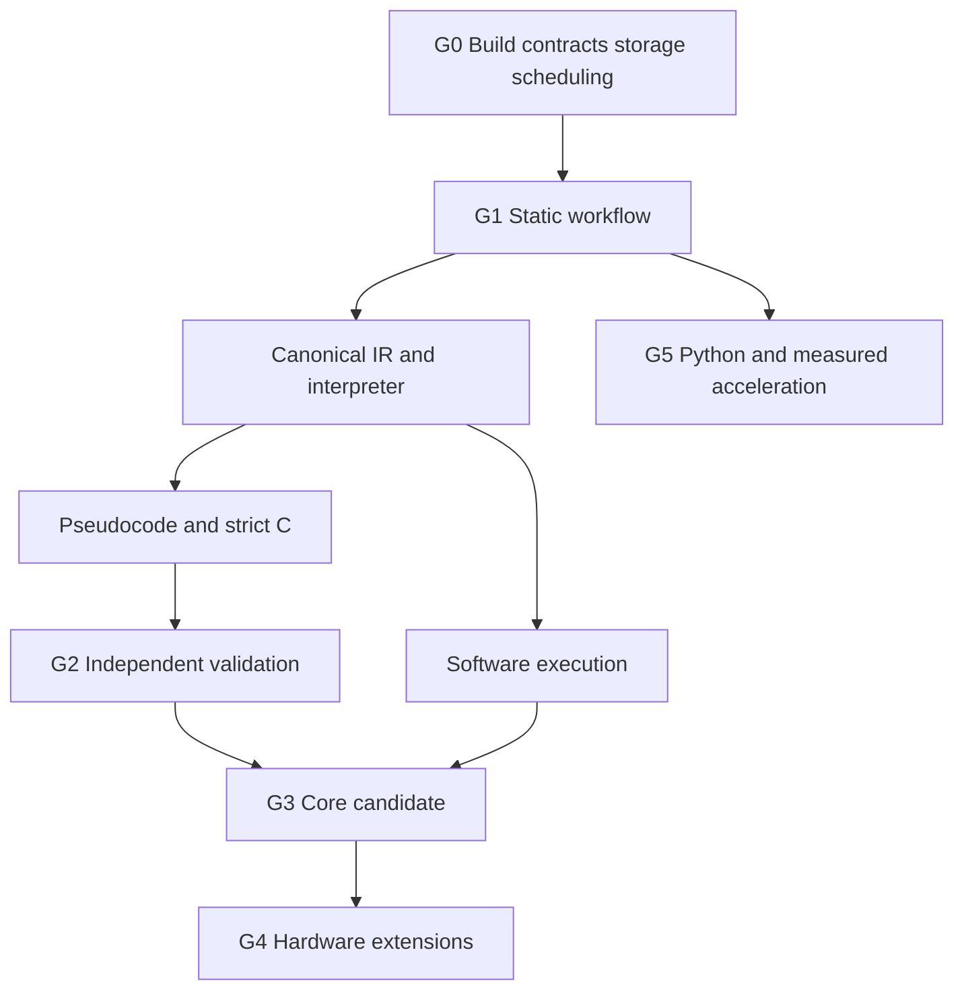

# Apple Silicon Reverse Engineering Workbench Engineering Plan

Version 1.0 • 26 September 2026 • Status: implementation plan, no implementation claimed

Baseline documents: Apple Silicon Reverse Engineering App Specification v1.0 and Apple Silicon RE Architecture Plan v1.0. The architecture defines the components. This plan defines the work, its order, the evidence required to accept it and the conditions that stop a release.

## 1 Delivery objective

Deliver a native macOS ARM64 workbench that performs useful binary inspection on an M2 Mac mini with 8 GB RAM, then adds a documented semantic subset, C export and controlled execution. Preserve the architecture's Swift application, Rust coordinator, disposable workers and optional Python extensions. Xcode owns application integration and packaging; Cargo owns Rust builds; native engines remain behind narrow adapters.

The initial engineering objective is an end-to-end static workflow with persistent annotations and failure recovery. The next objective is one real function translated to C and independently validated. These prove integration and semantic correctness before expanding instruction coverage or adding virtual machines.

All task statuses begin at planned. Budgets are targets to verify on the reference Mac. No task is done because a directory, class, mock response or disabled menu item exists.

## 2 Scope and release contract

| Release gate | User-visible result | Explicit boundary |
| --- | --- | --- |
| G0 Foundation | Signed app talks to its coordinator, schedules bounded work and recovers state | Internal engineering build |
| G1 Static preview | Capture ARM64 Mach-O/raw code, browse real assembly, inspect references and save annotations | No claim of general decompilation |
| G2 Semantic preview | Supported functions produce traceable pseudocode and strict C exports | Published instruction, ABI and runtime subset |
| G3 Core release candidate | Function harness, differential evidence and bounded software execution | Complete app execution and arbitrary firmware remain outside the function harness |
| G4 Hardware extension | Qualified Hypervisor harness and optional supported full guests | Host capabilities and RAM admission determine availability |
| G5 Extension release | Python SDK and measured optional acceleration | Core workflows still work without either |

G3 is the first candidate for the specification's initial complete product. G1 and G2 can be distributed as clearly labelled previews. A failed optional engine qualification reduces advertised scope; it does not justify a fake implementation.

## 3 Ownership and development rules

Use five logical engineering roles: platform/UI, core/storage, analysis/compiler, execution, and verification/release. One developer may perform all five. These roles identify review responsibilities rather than assume a staffed team.

Platform owns Xcode targets, XPC wrappers, native views and signed helper lifecycle. Core owns identities, protocol, project transactions, leases and scheduling. Analysis owns loader correctness, semantic coverage, IR, pseudocode and C emission. Execution owns harnesses, backend state and observability. Verification owns independent fixtures, failure injection, physical-Mac evidence and release claims.

For a solo workflow, review risky code in a second pass using the independent fixture or invariant, rather than rereading only the implementation. Work in small changes that each introduce one testable behavior. Keep at most one main feature and one bounded feasibility spike active. Build/test concurrency is separate from runtime concurrency; on the 8 GB machine, begin with at most two compiler jobs and avoid a native-engine build while a guest is running.

Every change records the affected requirement, architecture package, ticket, tests and known limitations. Protocol, schema and IR changes require explicit version-impact review. Do not add dependencies from loaders/analysis back into UI or storage implementations.

## 4 Entry criteria and toolchain qualification

Before G0, establish a reproducible development checkout and a local toolchain manifest. Record host model/RAM, macOS build, Xcode/SDK, Rust toolchain, Python runtime if used, native-engine revisions and configuration flags. Choose concrete supported versions during qualification; this plan does not invent a tested version matrix.

Build a native ARM64 development app with local/ad-hoc signing where supported. Developer ID signing and notarization are distribution gates; account access is not required to begin portable core work. Test privileged helpers with the signing configuration their actual APIs require and record limitations of development signing.

Provide an explicit dependency preparation command and an offline normal build after preparation. Lock Cargo dependencies, native revisions and Python dependencies. Keep dependency downloads out of ordinary Xcode build phases. The bootstrap diagnoses missing tools, inadequate disk space and unsupported hosts without modifying system-wide settings.

Proposed engineering commands, to be implemented rather than assumed to exist:

| Command | Purpose |
| --- | --- |
| scripts/doctor.sh | Inspect the host and print missing prerequisites |
| scripts/prepare-deps.sh | Fetch and verify pinned build dependencies |
| scripts/build-core.sh | Build Rust and minimal native adapters |
| scripts/build-app.sh | Build the selected Xcode scheme |
| scripts/test-portable.sh | Run core/model/IR/storage tests on supported hosts |
| scripts/test-macos.sh | Run XPC, lifecycle and platform tests |
| scripts/bench-reference.sh | Execute the recorded 8 GB workload manifest |
| scripts/package-release.sh | Produce a release only from a qualified source revision |

## 5 First two vertical slices

### VS1 Static workflow and recovery

Create a small known-source ARM64 Mach-O fixture, with source and build command retained. Open it through the app, capture its exact bytes, enumerate its executable section, decode a visible page in a worker, display real addresses/bytes/mnemonics, add a comment and close/reopen the project.

Then run a deliberately stalled test worker. Cancel it and verify UI acknowledgement, termination and retained annotations. Repeat with a worker crash and coordinator restart. Confirm no cancelled or previous-generation attempt can publish a late result. VS1 passes only on a real macOS build; portable tests alone do not satisfy it.

Evidence: source revision, fixture hash, signed build identity, logs, database integrity check, memory high-water mark and a short manual UI checklist. The checkpoint contains no decompiler prerequisite.

### VS2 Supported function to validated C

Use the source function `uint64_t add_u64(uint64_t a, uint64_t b) { return a + b; }`. Build a controlled AArch64 assembly fixture as well as compiler-produced variants. Do not depend on the compiler selecting one exact encoding in every version.

Capture and decode the fixture; lift its actual supported instructions to verified IR; interpret it; render pseudocode; emit C17; compile the export; run it in a separate worker; compare with the independently compiled source oracle. Test zero, one, maximum values, modular overflow and reproducible random pairs.

An unsupported instruction inserted into a reachable block must block strict export. A partial export, if requested, must trap explicitly. Test results identify the exact source/IR/export revisions and compiler settings. VS2 demonstrates one function, not general ARM64 correctness.

## 6 Dependency order

The critical path is A01, A02, A03, A04, A05, A08, A09, A10, A11 and A12, with A06 and release hardening required for a usable deliverable. A07 is a feasibility decision, not permission to block all work indefinitely. A13, A14 and A15 can be delivered as optional modules after their gates pass.

## 7 Engineering backlog

Each package below maps directly to the same A-number in the architecture. Ticket IDs are stable references for implementation commits and review. Every package has three independently reviewable tickets, giving 54 initial tickets. Split a ticket further if it cannot be demonstrated and reviewed as one coherent change.

### A01 Build foundation

Owner: platform/core. Dependencies: none.

- E01.1 Create the Xcode workspace, app and coordinator XPC targets, Cargo workspace and a command-line target. Add deterministic build scripts and an environment report.
- E01.2 Implement a minimal C ABI with opaque coordinator handle, explicit buffer release and typed status. Swift calls a real Rust operation through the helper, with no shared mutable global state.
- E01.3 Add development/release configurations, signed helper embedding and an offline build check after dependency preparation.

Gate: a clean checkout builds the app on macOS; the release-config app completes a Rust round trip; no panic or C++ exception crosses the ABI. Evidence includes a repeated-call allocation test and captured build versions. Do not create every optional helper target before it has runnable behavior.

### A02 Shared contracts

Owner: core. Dependency: A01.

- E02.1 Implement distinct checked address types, source/image/revision identities and diagnostic codes. Include high-bit addresses and section-relative relocatable references.
- E02.2 Implement versioned control envelopes, frame length validation, capability handshake and Swift/Rust/Python interoperability fixtures. Define canonical serialization used in artifact hashes.
- E02.3 Implement attempt IDs, coordinator-generation binding, lease references, sequence numbers and reconnect/query contracts.

Gate: truncated/oversized frames reject before large allocation; version mismatch is explicit; 64-bit addresses round-trip without signed or floating-point corruption. Golden fixtures verify cross-language compatibility even before the full Python SDK exists.

### A03 Persistence

Owner: core. Dependency: A02.

- E03.1 Implement project creation/opening, schema version checks, a single writer lock and separate durable annotation/rebuildable analysis tables.
- E03.2 Implement immutable object staging, validation, atomic promotion and database publication. Define synchronization policy for process-crash durability and separately document power-loss guarantees.
- E03.3 Implement recovery reconciliation, orphan cleanup, backup-before-migration and cache eviction exclusions.

Gate: crash injection before/after each publication step leaves no committed missing object. Disk-full failure preserves saved annotations. A second writer is refused. Newer schemas cannot be silently rewritten. Do not assume atomic rename alone establishes power-loss durability.

### A04 Scheduler and memory governor

Owner: core. Dependencies: A02–A03.

- E04.1 Implement a bounded priority queue, dependency DAG, deduplication and subscriber-aware cancellation.
- E04.2 Implement leases for memory, CPU and scratch disk; backend exclusivity; growth requests; global accounting across windows and engine thread pools.
- E04.3 Implement worker start/handshake, heartbeats, deadlines, cooperative cancel, termination, stale-attempt rejection and pressure-state transitions.

Gate: hung workers cannot block the control executor; cancelled jobs cannot publish; two windows do not double budgets. Deterministic simulated pressure validates policy, followed by a physical-Mac pressure test. Watchdog recovery is not described as a hard OS memory quota.

### A05 Import and decode

Owner: analysis. Dependency: A04.

- E05.1 Stream capture with bounded buffers, exact content hash, provisional metadata and detected-source-change handling. Parse only captured content for authoritative analysis.
- E05.2 Implement ARM64 Mach-O/raw loaders, universal slice selection, checked load commands/segments/sections and file-to-image mappings. Reject impossible ranges and encrypted-code analysis claims.
- E05.3 Integrate a minimal LLVM decoding adapter that returns typed operands and coverage, with paginated instruction artifacts and cancellation points.

Gate: real fixture bytes decode correctly and malformed inputs fail without UI failure. A 1 GiB fixture does not require whole-file allocation. Zero-fill and file-backed ranges map differently. Raw code requires explicit load configuration.

### A06 Static user interface

Owner: platform. Dependency: A05.

- E06.1 Implement import/project windows, paginated AppKit listing, hex view, selectable addresses and command routing.
- E06.2 Implement references, bookmarks, comments, rename history and synchronized navigation with origin tokens to prevent update loops.
- E06.3 Implement jobs/cancel UI, stale-result rejection, reconnect behavior, accessibility and a large-data interaction test.

Gate: VS1 passes. Rapid navigation cannot display results for the previous image/revision. VoiceOver/keyboard navigation can reach core actions. Main-thread traces contain no parsing or decompilation work.

### A07 Mature decompiler feasibility

Owner: analysis. Dependencies: A01, A02, A04.

- E07.1 Build a pinned native integration and document loader, architecture, symbol/type callback and lifecycle requirements.
- E07.2 Evaluate known-source stripped/unstripped functions in a disposable worker; measure total footprint, startup, cancellation and failure behavior.
- E07.3 Record a keep/reject ADR with dependency notices and supported artifact provenance. Integrate exploratory output only if the gate passes.

Gate: a reproducible qualification report, whether accepted or rejected. Stop after the agreed bounded experiment and decide; do not let integration uncertainty become an endless prerequisite. External pseudocode cannot mark strict export eligible.

### A08 Canonical semantics

Owner: analysis. Dependency: A05.

- E08.1 Implement versioned machine IR, verifier, bit-vector operations, explicit memory/fault effects and instruction provenance.
- E08.2 Implement the first instruction forms from the coverage ladder in section 10, including register aliases, zero extension and flags where applicable.
- E08.3 Implement the reference interpreter with harness-defined memory, step limits, deterministic state and reproducible fault reports.

Gate: malformed IR rejects; each enabled form has independent expected outcomes and edge cases. Unsupported effects survive optimization and prevent strict export. Interpreter state is serializable without host pointers.

### A09 Analysis and pseudocode

Owner: analysis. Dependency: A08.

- E09.1 Implement bounded function discovery, CFG construction, unknown indirect edges, dominators and SSA with explicit memory dependencies.
- E09.2 Implement constant propagation, conservative summaries, stack-slot hypotheses and bounded interprocedural fixed-point iteration.
- E09.3 Implement typed pseudocode AST/parser/renderer, labels/gotos and address mapping; separate inferred types from verified machine semantics.

Gate: loops/diamonds/irreducible graphs remain faithful; incomplete edges are visible. Supported AST round trips preserve semantics and origins. Rename changes invalidate presentation only; type/ABI changes invalidate dependent hypotheses.

### A10 C export

Owner: analysis. Dependency: A09.

- E10.1 Implement eligibility analysis with reachable unsupported-effect, ABI, dependency and memory-model blockers.
- E10.2 Implement machine-state C17, checked memory helpers, defined arithmetic/shift behavior and a restricted reconstructed-C path.
- E10.3 Emit source maps, dependencies, runtime version, hashes, scope and status in an atomic export directory.

Gate: VS2's export is real compilable C. Unsupported reachable instructions refuse strict export. No zero-return/empty-call substitutions. Generated status is never automatically promoted to validated status.

### A11 Independent validation

Owner: verification/analysis. Dependencies: A08, A10.

- E11.1 Implement a compiler runner with argument arrays, clean temporary directories and qualified toolchain discovery; avoid shell interpolation and project build-script execution.
- E11.2 Implement a separate native runner, declared observable-state comparison, deterministic seeds and timeout/fault reporting.
- E11.3 Implement source-oracle comparison, regression corpus and persistent counterexample reports bound to exact revisions.

Gate: VS2 passes and deliberately wrong output is detected. Distinguish compiler failure, runtime trap, timeout and mismatch. Shared lifter/interpreter agreement alone does not satisfy independent validation. Native runner isolation is qualified before untrusted generated programs are enabled.

### A12 Software execution

Owner: execution. Dependencies: A04, A08.

- E12.1 Implement backend capability contract and harness validation, memory permissions, import models and no-host-syscall behavior.
- E12.2 Integrate and qualify the selected Unicorn build, signed JIT behavior where applicable, stop/interrupt and instruction-family coverage.
- E12.3 Implement bounded traces, registers/memory UI and deterministic replay for the supported single-thread harness.

Gate: illegal accesses, unsupported instructions and loops terminate predictably. Trace saturation records gaps or pauses. If engine signing is not qualified, expose only qualified interpreter capabilities and block the advertised software-CPU backend.

### A13 Debugger integration

Owner: platform/execution. Dependencies: A04, A06.

- E13.1 Qualify LLDB packaging, bindings and target permissions with a user-built fixture process.
- E13.2 Implement launch/attach/detach, breakpoints, registers and process events through a separate helper.
- E13.3 Implement permission/error UX, target termination and reconnect handling without promising replay.

Gate: denied attachment is handled normally, and the app never requests that platform protections be disabled as standard setup. Debugging has explicit host-side-effect semantics distinct from the function harness.

### A14 Hypervisor harness

Owner: execution/platform. Dependencies: A04, A08, A12 for production integration.

- E14.1 Perform an early capability spike for signed helper launch, guest mappings, interruptibility and one controlled return. Keep it separate from the production backend claim.
- E14.2 Implement monitor vectors, page tables, stack/trampoline, exit dispatcher, memory faults and explicit imported-call traps.
- E14.3 Qualify the supported semantic profile against independent fixtures; add admission, teardown and backend-specific state reporting.

Gate: known pure functions agree with the oracle; unsupported guest features are denied before execution where detectable. Watchdog interruption works on the reference host. No full-SoC, cycle-accurate or arbitrary macOS-service claim.

### A15 Full guest mode

Owner: platform/execution. Dependencies: A04, A06.

- E15.1 Implement runtime guest-configuration validation, disk capacity checks, stable guest identity and RAM admission.
- E15.2 Qualify a guest-agent transport per guest profile, scoped authentication, command allowlist and hashed file transfer.
- E15.3 Implement boot/shutdown/lost-agent recovery; optional saved state only when supported and tested.

Gate: insufficient host headroom refuses launch with an explanation. Guest access features begin disabled. Agent loss cannot publish complete evidence. Pausing does not falsely release guest RAM in accounting.

### A16 Python SDK

Owner: core/platform. Dependencies: A02, A04, A06.

- E16.1 Package a pinned interpreter and paginated SDK for queries/jobs/annotation proposals.
- E16.2 Implement revision-checked mutation transactions, undo records, output limits and script cancellation.
- E16.3 Qualify restricted execution or explicitly label trusted-script mode; ensure no project auto-run behavior.

Gate: denied filesystem/network access is tested before claiming a sandbox. Stale script mutations fail without partial writes. Python objects cannot materialize an entire large project through a default query.

### A17 Optional acceleration

Owner: relevant component plus verification. Dependency: measured baseline and stable semantic fixtures.

- E17.1 Identify one measured bottleneck and write its CPU/reference benchmark before adding acceleration.
- E17.2 Implement a bounded SIMD/Metal/Core ML path appropriate to that workload, with capability and memory probes.
- E17.3 Compare correctness, latency, energy proxy/thermal behavior and memory; choose workload thresholds or reject the optimization.

Gate: an end-to-end improvement on relevant reference workloads, with fallback and no semantic regression. A functioning GPU kernel is not sufficient evidence. No blanket Neural Engine acceleration claim.

### A18 Release hardening

Owner: verification/platform. Dependencies: all packages advertised by the selected release.

- E18.1 Run compatibility, schema migration, offline, pressure, disk-full and fault-injection matrices; resolve release-blocking failures.
- E18.2 Build signed distribution artifacts, dependency inventory/notices, checksums and user documentation from one recorded revision.
- E18.3 Run physical 8 GB Mac acceptance, verify clean installation and publish a precise feature/coverage/limitations manifest.

Gate: no untested backend appears enabled by default. Required tests are executed, not merely present. Notarization and signing status are accurately recorded; unsigned engineering builds are not called release-ready.

## 8 Interface engineering contracts

Freeze these contracts before widening implementation. The listed names are proposed API operations, not existing source code.

| Contract | Required inputs | Result and invariant |
| --- | --- | --- |
| CaptureSource | Read-only input handle, limits, project ID | Immutable source hash/length; provisional data cannot enter export |
| LoadImage | Source identity, slice/raw configuration | Checked mappings and metadata revision |
| QueryInstructions | Image revision, range, page cursor | Bounded page with exact producing revision |
| SubmitJob | Operation, dependency keys, limits | Job ID; work cannot start without a lease |
| CancelJob | Job/subscriber scope and expected state | Cancellation acknowledgement; revoked attempts cannot publish |
| PublishArtifact | Attempt/generation/lease, staging reference, digest | Committed artifact only after validation and active authority check |
| MutateAnnotations | Expected annotation revision, operations | Atomic new revision and undo record or conflict |
| PrepareHarness | Frozen harness, backend/profile | Qualified session or explicit blockers |
| ExportC | Function/analysis revisions and policy | Export manifest or structured eligibility blockers |
| ValidateExport | Export/harness/oracle identities and comparison policy | Evidence bound to all exact input identities |

FFI exposes opaque handles and explicit allocation/free functions. Define ownership for every pointer and length. Catch recoverable panics at the boundary; process termination remains the fallback for corruption. Do not claim panic catching makes an invalid pointer safe.

Protocol framing rejects lengths above 256 KiB before body allocation. Bulk data uses versioned chunks and brokered handles. Cancellation and publication authorization are checked in the same serialized state domain to prevent a late-result race.

## 9 Storage and consistency tests

Use process-crash fault injection at staging creation, write completion, digest verification, object promotion, transaction begin, transaction commit and event publication. For each injection point, restart and assert that annotations are intact, committed artifacts exist and uncommitted attempts cannot masquerade as completed jobs.

Test cache invalidation by changing each key input independently: source bytes, slice, load base, decoder/lifter version, IR schema, ABI profile, analysis settings and relevant user override. Only unaffected artifacts may be reused. Tests must detect stale source maps as well as stale pseudocode.

Explicitly test high unsigned addresses, overflowing ranges, zero-length mappings, sparse files, zero-fill, conflicting sections, rebasing, symlink replacement and source mutation during capture. A byte-stream hash proves captured content identity; it does not prove a concurrent source was an atomic filesystem snapshot.

Backup tests restore an older project into a separate directory and verify identities, annotations and available artifacts. Migration tests retain an untouched recovery copy. Never test destructive recovery against the only copy of a user's project.

## 10 ISA and semantic coverage ladder

| Level | Intended scope | Required evidence before enablement |
| --- | --- | --- |
| C0 Decode | Known AArch64 encodings and feature flags | Exact bytes, lengths, operands and comparison fixtures |
| C1 Integer leaf | Selected MOV aliases, immediate/register arithmetic and return forms | Width, wraparound, alias and register-zero behavior |
| C2 Conditions | Selected comparisons, flag-setting forms and branches | N/Z/C/V edge cases and taken/not-taken paths |
| C3 Controlled memory | Selected loads/stores, stack access and address generation | Width, alignment policy, permissions, endianness and fault behavior |
| C4 Calls and loops | Direct calls, declared imports, loops and selected jump tables | ABI state, recursion/step limits and unresolved-edge rejection |
| C5 Additional families | FP/SIMD, atomics, authenticated operations and other extensions | Family-specific state, exception and concurrency semantics |

Coverage is per exact instruction form and execution/export backend. A library's decoder supporting an opcode does not promote its lift/export status. Initial strict C targets C1, then expands through C2–C4. C5 remains separate qualification work.

For every enabled form, keep raw encoding, disassembly, initial machine state, expected state/effects, source origin and oracle method. Add boundary and metamorphic tests where useful. Metamorphic agreement supplements independent expected results rather than replacing them.

## 11 Fixture and evidence catalogue

| Fixture ID | Purpose | Main gate |
| --- | --- | --- |
| FX01 | Small ARM64 Mach-O with source and symbols | Import/VS1 |
| FX02 | Same functionality optimized and stripped | Discovery/decompilation limits |
| FX03 | Universal binary with distinct slices | Slice/address correctness |
| FX04 | Raw code at high 64-bit addresses | Address serialization/storage |
| FX05 | Malformed headers, lengths and mappings | Parser containment |
| FX06 | Generated 1 GiB file with known sparse/real regions | Bounded capture/navigation |
| FX07 | Integer leaf and arithmetic boundaries | VS2/C1 |
| FX08 | Branches, loops, flags and unknown edges | C2/CFG |
| FX09 | Controlled memory, permissions and faults | C3/execution |
| FX10 | Known imported call plus missing import | Dependency/export blocking |
| FX11 | Deliberate worker hang/crash/late response | Recovery and cancellation |
| FX12 | Disk-full, stale revision and publication crash | Durable storage |
| FX13 | Trace saturation and replay seed | Trace truthfulness |
| FX14 | Debuggable fixture and denied target | LLDB lifecycle |
| FX15 | Minimal guest return and memory fault | Hypervisor qualification |
| FX16 | Guest below/above admission threshold | Full VM admission |
| FX17 | Restricted/trusted Python behavior | Plugin claims |
| FX18 | Changed IR/export/oracle inputs | Evidence invalidation |

Fixture manifests include provenance/licence, source hash, build command, toolchain, expected outcomes and applicable profiles. Generate large fixtures reproducibly instead of committing gigabytes to git. Host-native oracles execute only controlled test fixtures through the isolated runner.

A gate report records source commit, dirty-tree status, build configuration, fixture hashes, host details, test IDs/results, timestamps, resource measurements and unresolved limitations. Claims are based on passing evidence, not screenshots alone.

## 12 Resource verification on the reference Mac

Retain the 2,560 MiB static envelope and 3,072 MiB function-execution envelope from the architecture. Full VM mode separately admits guest RAM and overhead after reducing workbench allocations and preserving host headroom. The static sub-budgets sum to 2,560 MiB: 320 app/coordinator, 192 store/index, 256 image windows, 768 workers, 384 IR/cache, 128 Python, 128 graphics and 384 reserve.

Measure application/helper footprints, worker reservations, GPU allocations, guest commitments, swap delta, cancellation delay and UI latency. Do not sum shared memory twice or treat virtual address space as resident memory. Store enough measurement detail to explain the accounting method.

Test cold start, warm navigation, 1 GiB capture, repeated function switching, two windows, cancelled decompilation, runaway worker recovery and execution after cache eviction. Run signed release builds outside Xcode for acceptance; also document development overhead separately.

Targets: idle below 350 MiB; cached navigation p95 below 100 ms; cancellation UI acknowledgement within 100 ms; cooperative stop within one second and watchdog resolution within three seconds; critical-pressure policy begins within one second. These are unmeasured targets until the test report exists.

Collect at least 30 observations for reported latency distributions and multiple cold/warm runs where appropriate. Retain maxima and failures; do not discard slow runs silently. Freeze fixture and host conditions before comparing an optimization.

## 13 Continuous integration and release gates

Portable CI runs formatting/lint, model/protocol tests, storage recovery, IR verifier/interpreter, parser fuzz smoke tests and C-generation fixtures where supported. macOS CI runs the actual Xcode app/helper build, XPC integration, signing checks and compiler/runner integration. Physical reference-machine acceptance covers memory, responsiveness and hardware backends.

Pull requests run targeted tests for the changed behavior plus required contract gates. Nightly or scheduled engineering runs broaden fuzzing and failure injection. Release candidates run the full advertised-capability matrix. Do not require every optional hardware test for a static-only preview; do require that unqualified features remain unavailable and correctly labelled.

Release blockers include data loss, stale artifact publication, unsafe strict C eligibility, cancellation failure causing uncontrolled work, mandatory offline failure, incorrect backend claims and a memory regression that breaks the reference workflow. Cosmetic improvements do not delay a release once required usability/accessibility gates pass.

After a gate fails, preserve the failing fixture and fix the cause or reduce the advertised scope. Never change expected results merely to match current output without an independent semantic justification.

## 14 Feasibility decisions and fallback policy

Timebox a spike by a concrete experiment and a predeclared effort allowance after toolchain setup. Do not promise calendar dates before measuring the initial work. Each spike produces buildable experiment code and a qualification record.

| Uncertainty | Experiment | Decision if unsuccessful |
| --- | --- | --- |
| Native decompiler footprint/integration | Selected-function corpus in a disposable worker | Ship canonical supported subset; keep heavier workflow separate |
| LLVM adapter size and operands | Minimal target build plus typed operand extraction | Narrow targets and measure; do not parse display strings as authoritative semantics |
| Unicorn signing/JIT | Signed release helper on reference host | Disable backend; retain truthful interpreter capability |
| LLDB packaging | Clean-machine helper launch and binding test | Optional feature remains unavailable |
| Native validation isolation | Filesystem/network/process boundary tests | Allow C source export; block untrusted native execution until qualified |
| Hypervisor interruption and semantics | Controlled loop, return and fault fixtures | Keep software execution as default |
| Guest agent transport | Authenticated round trip on each guest profile | Disable that profile's introspection; do not silently expose networking |
| Python restriction enforcement | Negative access tests | Explicit trusted mode only |
| Acceleration benefit | Matched CPU/accelerated workload runs | Keep CPU path |

## 15 Change control and completion criteria

A ticket is ready when its inputs, owner role, dependencies, target files and observable result are identified. It is complete when implementation, meaningful tests, diagnostics, resource effects and documentation match the contract. An engineer must be able to reproduce its demonstration from the recorded checkout.

Schema/protocol/IR changes include compatibility behavior, cache invalidation and migration tests where relevant. Dependency upgrades include licence/notice changes, signed build verification and the relevant semantic corpus. Feature flags must hide unsupported capabilities without fabricating success results.

Each release freezes a capability manifest listing input formats, instruction coverage, execution backends, host requirements, C export subset and validation levels. The application and documentation derive visible availability from this manifest plus runtime probes. This prevents roadmap items appearing as shipped features.

## 16 Ordered starting queue

1. Implement E01.1–E01.3 and prove a signed Swift-to-Rust helper round trip.
2. Implement E02.1–E02.3 and establish wire/identity/address fixtures.
3. Implement E03.1–E03.3 with publication crash injection before UI feature work.
4. Implement E04.1–E04.3 using a deterministic fake worker that can hang, crash, over-request resources and return stale data. Fake workers are test infrastructure only.
5. Implement E05.1–E05.3 and E06.1–E06.3; complete VS1 and G1.
6. Run A07's bounded qualification; begin A08 on the independently useful supported subset.
7. Complete A09–A11 and VS2, then widen fixtures before widening semantics.
8. Complete A12 and G3 hardening; qualify hardware/debugger/plugins as separately gated modules.

The immediate handoff to implementation is steps 1–4, followed by VS1. Keep the specification, architecture and this engineering plan together in the future repository, and update task/evidence status as real code lands.
